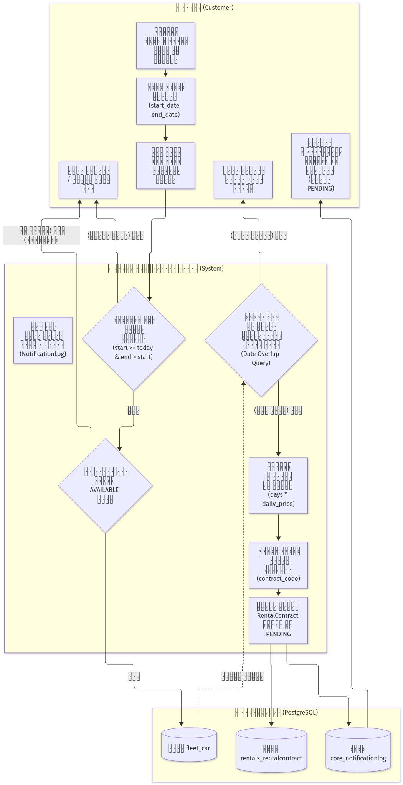
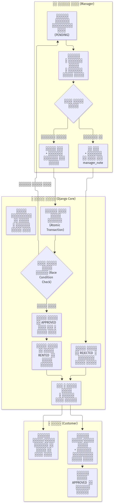
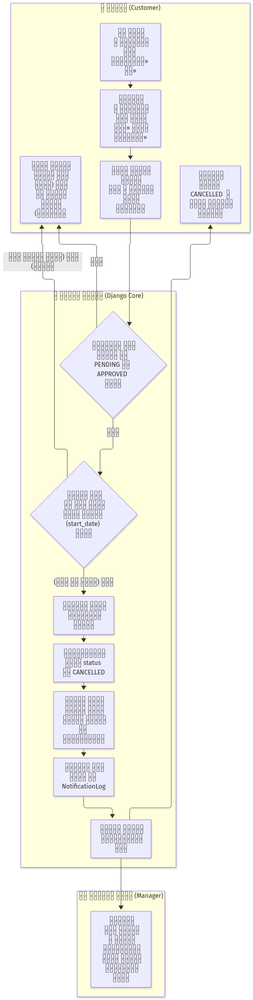

# سامانه جامع مدیریت و رزرواسیون اجاره خودرو (Car Rental System)
> **پروژه پایانی درس طراحی سیستم‌های تحت وب - دانشگاهی**  
> **توسعه‌دهندگان (Pair Programming):**  
> - **سروش حامدی** (`SoroushHamedi-Net`) - <soroush.hamedi.cs@gmail.com>  
> - **نورا اسفرد** (`Noora-NF`) - <norasfardnoora@gmail.com>  

---

## ۱. معرفی و شرح پروژه
این پروژه یک سامانه جامع و مدرن تحت وب جهت مدیریت ناوگان، رزرواسیون آنلاین، اعتبارسنجی تداخل زمانی و صدور دیجیتال قراردادهای اجاره خودرو است که با بهره‌گیری از فریم‌ورک قدرتمند **Django 5** و پایگاه داده رابطه‌ای **PostgreSQL** پیاده‌سازی شده است.

### نقش‌های کاربری سیستم:
1. **مدیر سامانه (Manager):**
   - مدیریت ناوگان و برندهای خودرو (ثبت، ویرایش، تعیین مشخصات فنی و آپشن‌ها).
   - کنترل بلادرنگ وضعیت خودروها (`AVAILABLE` / `MAINTENANCE` / `RENTED`).
   - مشاهده کارتابل رزرواسیون‌ها و تأیید یا رد قراردادها به همراه درج توضیحات کارشناسی.
   - داشبورد مدیریتی جامع و آمارهای عملکردی.
2. **مشتری / کاربر عادی (Customer):**
   - ثبت‌نام، احراز هویت دو مرحله‌ای (ایمیل و پیامک OTP).
   - مشاهده لیست ناوگان خودرو با صفحه‌بندی (Pagination) و فیلتر پیشرفته بر اساس برند، مدل، ظرفیت و اسلایدر محدوده قیمت (Price Range).
   - مشاهده جزئیات خودرو و مکان تحویل بر روی نقشه تعاملی (Leaflet.js + OpenStreetMap).
   - ثبت درخواست رزرو با اعتبارسنجی بلادرنگ عدم تداخل تقویمی.
   - داشبورد پیگیری وضعیت سفارشات و امکان لغو درخواست‌های پیش از موعد.

---

## ۲. پشته فناوری (Technology Stack)
- **Backend:** Python 3.14 + Django 5.1
- **Database:** PostgreSQL 18 + `psycopg2-binary`
- **Frontend:** HTML5, CSS3, JavaScript (Fetch API / AJAX), Bootstrap 5 RTL, Vazirmatn Font
- **Maps:** Leaflet.js & OpenStreetMap
- **Environment Management:** Python venv, `python-decouple` (.env)
- **Version Control:** Git & GitHub (Co-authored Commits)

---

## ۳. فرآیندهای اصلی کسب‌وکار و دیاگرام‌ها (Process Diagrams)

کلیه فرآیندهای کسب‌وکار مطابق با استاندارد فرآیندی در فایل مستندات [docs/PROCESS_DIAGRAMS.md](docs/PROCESS_DIAGRAMS.md) مستند گردیده است.

### فرآیند ۱: ثبت درخواست اجاره خودرو و بررسی هوشمند تداخل زمانی و موجودی


---

### فرآیند ۲: بررسی، تأیید یا رد درخواست اجاره توسط مدیر، صدور قرارداد و ارسال اعلان


---

### فرآیند ۳: لغو درخواست اجاره توسط مشتری و آزادسازی منابع سیستم


---

### فرآیند ۴: بازگشت خودرو، بازرسی فنی و مدیریت چرخه وضعیت تعمیرگاه


---

## ۴. ساختار معماری پروژه (Modular Apps)
پروژه از ۴ ماژول ساختاریافته تشکیل شده است:
- `accounts`: مدل سفارشی کاربر (`CustomUser`)، سطوح دسترسی (`Manager` / `Customer`)، احراز هویت پیامکی/ایمیلی.
- `fleet`: مدل برند (`CarBrand`)، مدل خودرو (`Car`)، مدیریت موقعیت جغرافیایی تحویل، وضعیت تعمیرگاه و فیلترها.
- `rentals`: مدل قرارداد (`RentalContract`)، اعتبارسنجی تاریخ‌ها و تداخل زمانی، گردش کار تایید/رد و لغو.
- `core`: صفحات اصلی، سیستم لاگینگ جامع، جدول اعلان‌ها (`NotificationLog`) و سرویس‌های سیستمی.

---

## ۵. راهنمای راه‌اندازی سریع (Getting Started)

```bash
# ۱. فعال‌سازی محیط مجازی
.\venv\Scripts\activate

# ۲. نصب وابستگی‌ها
pip install -r requirements.txt

# ۳. تنظیم متغیرهای محیطی
# فایل .env را بر مبنای .env.example ایجاد کنید

# ۴. اعمال مایگریشن‌های دیتابیس PostgreSQL
python manage.py migrate

# ۵. اجرای سرور توسعه
python manage.py runserver
```

---

## ۶. بکاپ‌های پایگاه داده (Database Backups)
نسخه‌های پشتیبان مرحله به مرحله پایگاه‌داده در پوشه [backups/](backups/) نگهداری می‌شوند:
- `backups/phase1_db_backup.json` & `backups/phase1_postgres.sql`
