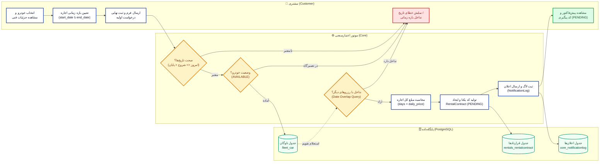
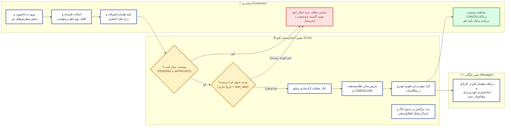
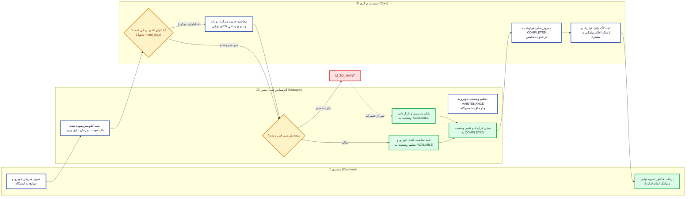

# مستندات فرآیندهای کسب‌وکار سامانه اجاره خودرو (Car Rental System)

این سند شامل نمودارهای جریان فرآیندی (Process Diagrams) برای ۴ فرآیند اصلی، پیچیده و غیربدیهی سامانه مدیریت اجاره خودرو است. این نمودارها با استفاده از فونت‌های استاندارد فارسی (**وزیرمتن** و **تاهما**)، چینش افقی و متوازن (بدون نوارهای باریک عمودی)، و کیفیت فوق‌العاده **۳X Retina Ultra-HD** رندر شده‌اند.

> 💡 **نکته:** جهت ارائه کلاسی پویا و تعاملی با قابلیت زوم بی‌نهایت، صفحه اختصاصی [docs/diagrams/present_diagrams.html](diagrams/present_diagrams.html) را در مرورگر باز کنید.

---

## فهرست فرآیندهای اصلی
1. [فرآیند ۱: ثبت درخواست اجاره خودرو و بررسی هوشمند تداخل زمانی و موجودی](#۱-فرآیند-ثبت-درخواست-اجاره-خودرو-و-بررسی-هوشمند-تداخل-زمانی-و-موجودی)
2. [فرآیند ۲: بررسی، تأیید یا رد درخواست اجاره توسط مدیر، صدور قرارداد و ارسال اعلان](#۲-فرآیند-بررسی-تأیید-یا-رد-درخواست-اجاره-توسط-مدیر-صدور-قرارداد-و-ارسال-اعلان)
3. [فرآیند ۳: لغو درخواست اجاره توسط مشتری و آزادسازی منابع سیستم](#۳-فرآیند-لغو-درخواست-اجاره-توسط-مشتری-و-آزادسازی-منابع-سیستم)
4. [فرآیند ۴: بازگشت خودرو، بازرسی فنی و مدیریت چرخه وضعیت تعمیرگاه](#۴-فرآیند-بازگشت-خودرو-بازرسی-فنی-و-مدیریت-چرخه-وضعیت-تعمیرگاه)

---

## ۱. فرآیند ثبت درخواست اجاره خودرو و بررسی هوشمند تداخل زمانی و موجودی

### ۱.۱. هدف فرآیند
هدف این فرآیند دریافت پارامترهای زمانی و انتخاب خودرو توسط مشتری، بررسی صحت تاریخ‌ها (عدم انتخاب تاریخ گذشته و تقدم تاریخ شروع بر پایان)، اعتبارسنجی عدم تداخل زمانی با قراردادهای تأیید شده قبلی یا در حال بررسی، محاسبه خودکار مبلغ پیش‌فاکتور بر مبنای نرخ روزانه، و در نهایت ثبت اولیه قرارداد در وضعیت «در انتظار بررسی مدیر» (PENDING) به همراه ثبت لاگ اعلان در سیستم است.

### ۱.۲. نقش‌های درگیر
- **مشتری (Customer):** جستجو و فیلتر خودروها، انتخاب بازه تاریخی، مشاهده پیش‌فاکتور و ارسال درخواست اجاره.
- **سیستم (System / Django Core):** اعتبارسنجی تاریخ‌ها، اجرای کوئری هم‌پوشانی زمانی (`Q(start_date__lte=end) & Q(end_date__gte=start)` و وضعیت APPROVED/PENDING)، محاسبه هزینه کل و ایجاد رکورد قرارداد.
- **پایگاه داده (PostgreSQL):** ذخیره رکورد تراکنشی در جدول `rentals_rentalcontract` و ثبت گزارش در `core_notificationlog`.

### ۱.۳. مراحل اصلی، نقاط تصمیم‌گیری و شرایط خطا
1. **ورود مشتری و انتخاب خودرو:** مشتری از صفحه جزئیات خودرو بازه اجاره (`start_date` تا `end_date`) را تعیین می‌کند.
2. **بررسی اعتبارسنجی فرم (نقطه تصمیم ۱):** آیا تاریخ شروع بعد از امروز است و تاریخ پایان بزرگتر از تاریخ شروع است؟
   - *شرط خطا:* نمایش پیام خطای تاریخ نامعتبر به کاربر بدون کسر یا تغییر رکوردها.
3. **بررسی وضعیت جاری خودرو (نقطه تصمیم ۲):** آیا وضعیت کلی خودرو `AVAILABLE` است یا در دست تعمیر (`MAINTENANCE`)؟
   - *شرط خطا:* اعلام عدم دسترسی به خودرو به علت تعمیرات فنی.
4. **بررسی عدم تداخل زمانی رزرواسیون (نقطه تصمیم ۳):** آیا این خودرو در بازه انتخابی با هیچ قرارداد فعال و تأییدشده‌ای تداخل زمانی دارد؟
   - *شرط خطا:* اعلام تداخل بازه زمانی و پیشنهاد انتخاب تاریخ‌های دیگر به مشتری.
5. **محاسبه مالی و صدور پیش‌نویس:** محاسبه تعداد روزها، ضرب در نرخ روزانه خودرو، ایجاد کد یکتای قرارداد (مانند `CR-XXXXXXXX`) و تغییر وضعیت به `PENDING`.
6. **پایان:** ارسال پیامک/ایمیل ثبت موفق درخواست به مشتری و ارسال اعلان به کارتابل مدیر.

### ۱.۴. نمودار فرآیند (Process Diagram 1)

*(نسخه وکتور SVG با کیفیت نامحدود: [process_1_rental_request.svg](diagrams/process_1_rental_request.svg))*

---

## ۲. فرآیند بررسی، تأیید یا رد درخواست اجاره توسط مدیر، صدور قرارداد و ارسال اعلان

### ۲.۱. هدف فرآیند
هدف این فرآیند ایجاد گردش‌کار تصمیم‌گیری مدیر بر روی درخواست‌های رزرو ثبت‌شده، جلوگیری از خطاهای انسانی در واگذاری خودرو، درج یادداشت مدیریتی، تغییر وضعیت قطعی قرارداد به `APPROVED` یا `REJECTED`، تغییر وضعیت ناوگان خودرو به `RENTED` در زمان شروع، و ارسال اعلان رسمی به مشتری است.

### ۲.۲. نقش‌های درگیر
- **مدیر سامانه (Manager):** مشاهده کارتابل درخواست‌های معلق، بررسی هویت و تاریخچه مشتری، اعلام تصمیم (تأیید یا رد) همراه با درج یادداشت مدیریتی.
- **سیستم (System / Django Core):** کنترل دسترسی مدیر (`@manager_required`)، بازبینی مجدد عدم تداخل ناهمگام در یک تراکنش اتمیک (`transaction.atomic`)، به‌روزرسانی وضعیت قرارداد و وضعیت فیزیکی خودرو، تریگر کردن سرویس اعلان ایمیلی و پیامکی.
- **مشتری (Customer):** دریافت پیامک و ایمیل نتیجه تصمیم مدیر و مشاهده وضعیت در داشبورد کاربری.

### ۲.۳. مراحل اصلی، نقاط تصمیم‌گیری و شرایط خطا
1. **ورود مدیر به داشبورد مدیریت:** فیلتر درخواست‌ها در وضعیت `PENDING`.
2. **بررسی مدارک و اعتبارسنجی نهایی (نقطه تصمیم ۱):** مدیر جزئیات سفارش و مدارک مشتری را بررسی می‌کند.
3. **تصمیم‌گیری مدیر (نقطه تصمیم ۲):** مدیر یکی از دو گزینه «تأیید» یا «رد درخواست» را به همراه یادداشت توضیحی ثبت می‌کند.
   - **در صورت رد درخواست (REJECTED):** وضعیت قرارداد به `REJECTED` تغییر کرده، یادداشت مدیر ذخیره می‌شود، تداخل زمانی از روی خودرو برداشته شده و ایمیل/پیامک عدم تأیید با ذکر دلیل برای مشتری ارسال می‌شود.
   - **در صورت تأیید (APPROVED):** سیستم یکبار دیگر عدم تداخل همزمان با رزرو دیگری را در یک تراکنش اتمیک (`transaction.atomic`) چک می‌کند تا از برخورد دو مدیر همزمان (Race Condition) جلوگیری شود.
     - *در صورت موفقیت:* وضعیت قرارداد به `APPROVED` تغییر می‌کند، وضعیت خودرو به `RENTED` درمی‌آید و اعلان حاوی جزئیات تحویل برای مشتری صادر می‌شود.

### ۲.۴. نمودار فرآیند (Process Diagram 2)

*(نسخه وکتور SVG با کیفیت نامحدود: [process_2_manager_review.svg](diagrams/process_2_manager_review.svg))*

```mermaid
flowchart LR
    subgraph Manager ["👨‍💼 مدیر سامانه (Manager)"]
        direction TB
        M1["مشاهده کارتابل درخواست‌های<br/>معلق (وضعیت PENDING)"] --> M2["بررسی مدارک و پیشینه<br/>مشتری متقاضی"]
        M2 --> M_DEC{"تصمیم مدیر؟"}
        M_REJ["ثبت رد درخواست +<br/>درج دلیل در manager_note"]
        M_APP["ثبت تأیید درخواست +<br/>دستورالعمل تحویل"]
    end

    subgraph System ["⚙️ سیستم مرکزی (Django Core)"]
        direction TB
        S_ATOMIC["آغاز تراکنش اتمیک<br/>(transaction.atomic)"]
        S_CHECK{"بررسی تداخل همزمان؟<br/>(Race Condition Check)"}
        S_SET_REJ["تغییر وضعیت به REJECTED<br/>و آزادسازی تقویم خودرو"]
        S_SET_APP["تغییر وضعیت به APPROVED<br/>و قفل قطعی بازه زمانی"]
        S_CAR_STATUS["تنظیم وضعیت خودرو به RENTED<br/>در تقویم ناوگان"]
        S_NOTIF["تولید و ثبت اعلان رسمی<br/>(ایمیل و پیامک OTP/اطلاع‌رسانی)"]
    end

    subgraph Customer ["👤 مشتری (Customer)"]
        direction TB
        C_REJ["دریافت پیامک رد درخواست<br/>به همراه دلیل مدیر"]
        C_APP["دریافت پیامک تأیید رزرو +<br/>دستورالعمل تحویل خودرو"]
        C_DASH["مشاهده قرارداد فعال و<br/>پیش‌فاکتور در داشبورد"]
    end

    M_DEC -- "رد درخواست" --> M_REJ --> S_SET_REJ --> S_NOTIF --> C_REJ
    M_DEC -- "تأیید درخواست" --> M_APP --> S_ATOMIC --> S_CHECK
    S_CHECK -- "تداخل همزمان" --> M1
    S_CHECK -- "بدون تداخل" --> S_SET_APP --> S_CAR_STATUS --> S_NOTIF --> C_APP --> C_DASH

    classDef default fill:#ffffff,stroke:#1e40af,stroke-width:2.5px,color:#0f172a;
    classDef decision fill:#fef3c7,stroke:#d97706,stroke-width:2.5px,color:#78350f;
    classDef error fill:#fee2e2,stroke:#dc2626,stroke-width:2.5px,color:#991b1b;
    classDef success fill:#dcfce7,stroke:#16a34a,stroke-width:2.5px,color:#14532d;
    class M_DEC,S_CHECK decision;
    class M_REJ,C_REJ error;
    class S_SET_APP,C_APP,C_DASH success;
```

---

## ۳. فرآیند لغو درخواست اجاره توسط مشتری و آزادسازی منابع سیستم

### ۳.۱. هدف فرآیند
هدف این فرآیند امکان لغو درخواست‌های اجاره توسط مشتری با رعایت قوانین زمانی سامانه (عدم امکان لغو پس از شروع تاریخ قرارداد یا اتمام موعد مجاز)، آزادسازی بلادرنگ خودرو در تقویم رزرواسیون، ثبت علت انصراف، به‌روزرسانی وضعیت به `CANCELLED`، و اطلاع‌رسانی خودکار به مدیر ناوگان جهت آماده‌سازی مجدد خودرو برای سایر مشتریان است.

### ۳.۲. نقش‌های درگیر
- **مشتری (Customer):** درخواست لغو سفارش از طریق داشبورد سفارش‌های من و درج دلیل انصراف.
- **سیستم (System / Django Core):** بررسی صلاحیت زمانی لغو (قبل از `start_date` بودن)، بررسی مجاز بودن وضعیت فعلی (تنها سفارش‌های PENDING یا APPROVED لغو می‌شوند)، تغییر وضعیت به `CANCELLED` و به‌روزرسانی تقویم ناوگان.
- **مدیر سامانه (Manager):** دریافت هشدار آزادسازی خودرو جهت بررسی در پنل ناوگان.

### ۳.۳. مراحل اصلی، نقاط تصمیم‌گیری و شرایط خطا
1. **ورود مشتری به داشبورد سفارشات:** مشتری لیست قراردادهای خود را مشاهده و دکمه لغو را انتخاب می‌کند.
2. **بررسی وضعیت قرارداد (نقطه تصمیم ۱):** آیا وضعیت فعلی قرارداد `PENDING` یا `APPROVED` است؟
   - *شرط خطا:* اگر قرارداد قبلاً `COMPLETED` یا `CANCELLED` شده باشد، عملیات متوقف می‌شود.
3. **بررسی مهلت زمانی لغو (نقطه تصمیم ۲):** آیا زمان فعلی قبل از تاریخ شروع قرارداد (`start_date`) است؟
   - *شرط خطا:* نمایش پیام خطای «امکان لغو قرارداد بعد از فرا رسیدن موعد تحویل وجود ندارد؛ لطفاً با پشتیبانی تماس بگیرید».
4. **اجرای لغو و آزادسازی تقویم:**
   - تغییر وضعیت قرارداد به `CANCELLED`.
   - تغییر وضعیت تقویمی خودرو به منظور در دسترس قرار گرفتن برای سایر مشتریان.
   - ثبت تاریخ و زمان لغو در لاگ‌های سیستم.
5. **ارسال اعلان‌ها:** ارسال تأییدیه لغو به مشتری و ارسال هشدار لغو به کارتابل مدیر.

### ۳.۴. نمودار فرآیند (Process Diagram 3)

*(نسخه وکتور SVG با کیفیت نامحدود: [process_3_cancellation.svg](diagrams/process_3_cancellation.svg))*

---

## ۴. فرآیند بازگشت خودرو، بازرسی فنی و مدیریت چرخه وضعیت تعمیرگاه

### ۴.۱. هدف فرآیند
هدف این فرآیند ثبت و اتمام چرخه حیات اجاره خودرو است. پس از پایان موعد قرارداد، خودرو به مرکز تحویل داده شده و بازرسی کارشناسی (بدنه، فنی، کیلومتر پیموده شده و سوخت) انجام می‌پذیرد. در صورتی که خودرو نیاز به سرویس یا تعمیر داشته باشد، وضعیت ناوگان به `MAINTENANCE` تغییر یافته و از چرخه اجاره خارج می‌شود تا سرویس انجام پذیرد؛ پس از رفع عیب، به وضعیت `AVAILABLE` بازگردانده شده و قرارداد به حالت `COMPLETED` منتقل می‌شود.

### ۴.۲. نقش‌های درگیر
- **مشتری (Customer):** تحویل فیزیکی خودرو در محل تعیین‌شده در پایان بازه زمانی.
- **کارشناس / مدیر سامانه (Manager):** ثبت کیلومتر نهایی، بررسی فیزیکی بدنه و موتور، ثبت فرم تحویل و تعیین سلامت یا نیاز به تعمیر.
- **سیستم (System / Django Core):** اعتبارسنجی پایان قرارداد، تغییر وضعیت به `COMPLETED`، مدیریت وضعیت وضعیت خودرو (`AVAILABLE` یا `MAINTENANCE`) در جدول `fleet_car`، ثبت هزینه‌ها یا تأخیر در صورت وجود، و صدور گزارش کارکرد خودرو.

### ۴.۳. مراحل اصلی، نقاط تصمیم‌گیری و شرایط خطا
1. **تحویل خودرو:** مشتری خودرو را در پایان موعد به ایستگاه تحویل می‌دهد.
2. **بررسی تاخیر در تحویل (نقطه تصمیم ۱):** آیا تاریخ تحویل با تاریخ پایان قرارداد مطابقت دارد یا دیرکرد دارد؟
   - در صورت دیرکرد: محاسبه جریمه روزهای دیرکرد بر مبنای نرخ روزانه و درج در صورتحساب نهایی.
3. **بازرسی فنی و ظاهری (نقطه تصمیم ۲):** مدیر خودرو را چک می‌کند: آیا خودرو نیاز به تعمیرات فنی یا نقاشی دارد؟
   - **در صورت نیاز به تعمیرات:**
     - وضعیت خودرو در جدول `fleet_car` به `MAINTENANCE` تغییر می‌کند.
     - یادداشت فنی سرویس ثبت شده و خودرو در لیست خودروهای قابل رزرو قفل می‌شود.
     - پس از انجام تعمیرات توسط تعمیرگاه، مدیر با دکمه اختصاصی وضعیت را مجدداً به `AVAILABLE` برمی‌گرداند.
   - **در صورت سلامت کامل خودرو:**
     - وضعیت خودرو بلافاصله به `AVAILABLE` تغییر می‌کند تا مشتریان جدید بتوانند آن را رزرو کنند.
4. **خاتمه قرارداد:** وضعیت قرارداد به `COMPLETED` تغییر یافته، فاکتور نهایی بسته شده و پیام تشکر به همراه نظرسنجی برای مشتری ارسال می‌گردد.

### ۴.۴. نمودار فرآیند (Process Diagram 4)

*(نسخه وکتور SVG با کیفیت نامحدود: [process_4_vehicle_return.svg](diagrams/process_4_vehicle_return.svg))*

---

## ۵. ماتریس انطباق فرآیندها با نیازمندی‌های پروژه

| عنوان فرآیند | نقش‌های درگیر | مدل‌های داده‌ای مرتبط | نوع نمودار | وضعیت پیاده‌سازی |
| :--- | :--- | :--- | :--- | :--- |
| **۱. ثبت درخواست اجاره و بررسی تداخل** | مشتری، سیستم | `CustomUser`, `Car`, `RentalContract` | Mermaid Flowchart LR + Swimlanes | پیاده‌سازی کامل در فاز ۱ و ۲ |
| **۲. بررسی، تایید یا رد درخواست توسط مدیر** | مدیر، سیستم، مشتری | `RentalContract`, `Car`, `NotificationLog` | Mermaid Flowchart LR + Decisions | پیاده‌سازی کامل در فاز ۱ و ۲ |
| **۳. لغو درخواست اجاره توسط مشتری** | مشتری، سیستم، مدیر | `RentalContract`, `Car`, `NotificationLog` | Mermaid Flowchart LR + Validation | پیاده‌سازی کامل در فاز ۱ و ۲ |
| **۴. بازگشت خودرو و مدیریت وضعیت تعمیرگاه** | مشتری، مدیر، سیستم | `Car`, `RentalContract` | Mermaid Flowchart LR + State Loop | پیاده‌سازی کامل در فاز ۱ و ۲ |
